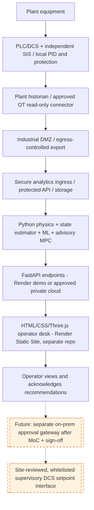

# DEPLOYMENT_GUIDE - RK-DRI Twin (two GitHub repositories, Render, local and on-prem)

Product: **RK-DRI Twin** by Extractmet Private Limited. Release label: **SIMULATOR (synthetic demo)**.
Two independent repositories:

| Repository | Content | Render service |
|---|---|---|
| `rotary-kiln-dri-backend` | Python 3.13, FastAPI, physics/ML/MPC, SQLite/Postgres, Dockerfile, `render.yaml` | Web Service (Docker) |
| `rotary-kiln-dri-frontend` | Vite + vanilla JS + Three.js + Plotly, `render.yaml` | Static Site |

> The public cloud is **not** a real-time deterministic OT controller. Outages of this service never affect safety functions or
> local PID loops. There is no PLC/DCS write path anywhere in the code.

  (source: `architecture.mmd`)

## 1. Local development
### Backend
```bash
cd rotary-kiln-dri-backend
python3.13 -m venv .venv && source .venv/bin/activate        # Windows: .venv\Scripts\activate
pip install -r requirements-dev.txt
cp .env.example .env                                         # optional; defaults work for the demo
python -m uvicorn app.main:app --host 127.0.0.1 --port 8000 --reload
# open http://127.0.0.1:8000/docs  (OpenAPI)   and   /health/ready
bash scripts/run_all_tests.sh                                # ruff + compile + pytest (~6-10 min; physics tests solve real steady states)
python scripts/smoke_api.py http://127.0.0.1:8000
```
SQLite database is created at `data/twin.db`; precomputed baseline fixtures are registered as cached runs at start-up.
### Frontend
```bash
cd rotary-kiln-dri-frontend
npm ci
cp .env.example .env.local          # VITE_API_BASE_URL=http://127.0.0.1:8000
npm run dev                          # http://localhost:5173
npm test                             # vitest unit tests
npm run build && npm run preview     # production bundle on http://localhost:4173
BASE=http://127.0.0.1:4173 npm run e2e   # Playwright smoke test over all 14 screens (needs `npx playwright install chromium`)
```
If the backend is unreachable the UI shows **OFFLINE STATIC DEMO** and renders bundled precomputed results (clearly labelled);
the simulator, MPC and data screens require the API.

## 2. GitHub
```bash
# backend
cd rotary-kiln-dri-backend && git init && git add . && git commit -m "RK-DRI Twin backend 1.0.0"
git branch -M main && git remote add origin https://github.com/<org>/rotary-kiln-dri-backend.git && git push -u origin main
# frontend
cd ../rotary-kiln-dri-frontend && git init && git add . && git commit -m "RK-DRI Twin frontend 1.0.0"
git branch -M main && git remote add origin https://github.com/<org>/rotary-kiln-dri-frontend.git && git push -u origin main
```
GitHub Actions (`.github/workflows/ci.yml`) run lint, tests and builds on every push from a clean clone. Keep both repositories
private; never commit `.env`, plant tags, credentials or real plant data.

## 3. Render - backend Web Service
1. Render dashboard -> **New -> Blueprint** -> select the backend repo (uses `render.yaml`), or **New -> Web Service ->
   Docker** with root = repo root.
2. Start command (Dockerfile CMD): `uvicorn app.main:app --host 0.0.0.0 --port ${PORT:-10000} --workers 1 --proxy-headers`.
3. Health check path: `/health/ready`.
4. Environment variables (Render environment manager - values never in Git):

| Variable | Example | Notes |
|---|---|---|
| `APP_ENV` | `demo` / `production` | production refuses to start without `SECRET_KEY` |
| `SECRET_KEY` | generated | token signing |
| `DEMO_PUBLIC` | `true` | anonymous read + simulate (public demo only) |
| `DEMO_USER_PASSWORD` | set manually | enables `demo_<role>` accounts |
| `ALLOWED_ORIGINS` | `https://rk-dri-twin-web.onrender.com` | **exact** frontend origin(s), comma-separated; CORS allowlist |
| `DATABASE_URL` | empty or `postgresql+psycopg://...` | empty = SQLite in container (ephemeral without a disk) |
| `MAX_JOB_WORKERS` | `1` | worker processes for simulations |

5. Deploy, then verify: `curl https://<backend-host>/health/ready` and `python scripts/smoke_api.py https://<backend-host>`.

**Sizing**: a steady solve takes ~20-35 s on one modern core; on Render *free* (0.1 CPU, 512 MB, sleeps after idle, cold start
~1 min) expect several minutes per custom run - use **Starter/Standard** for demos to customers. Baseline results for all four
presets are precomputed and returned instantly. Memory: ~350-450 MB with one worker process.
**Persistence**: attach a Render Disk at `/app/data` or set `DATABASE_URL` to Render Postgres; then run `bash scripts/migrate.sh`
(Alembic `upgrade head`). Without persistence, runs/audit are lost on redeploy (demo only).

## 4. Render - frontend Static Site
1. **New -> Static Site** -> frontend repo (or Blueprint with its `render.yaml`).
2. Build command `npm ci && npm run build`, publish directory `dist`.
3. Environment variable at **build time**: `VITE_API_BASE_URL=https://<backend-host>` (no trailing slash). Rebuild after changing.
4. Routing uses hash URLs (`#/twin`), so no SPA rewrite rule is required.
5. Set the backend `ALLOWED_ORIGINS` to the static site URL, redeploy backend, then open the site: header badge must show
   **API ready**. If it shows OFFLINE STATIC DEMO, check (a) VITE_API_BASE_URL baked into the bundle, (b) CORS origin match
   (scheme + host, no slash), (c) backend asleep (wait for cold start).

## 5. Modes and switching
`DEFAULT_MODE=DEMO_SYNTHETIC` (watermarked synthetic data). OFFLINE_SIMULATION is selected per request. HISTORICAL_REPLAY uses the
historian replay adapter with causal ordering. SHADOW/ADVISORY need a site read-only data feed (REST push or on-prem connector)
and enforce data-freshness gates. SITE_SUPERVISORY is disabled in code (`SUPERVISORY_ENABLED = False`).

## 6. Secure on-prem / private production architecture
* Deploy the backend in the plant analytics zone or a private cloud tenant behind TLS (corporate PKI, automated renewal),
  OIDC/SSO (replace `app/core/security.authenticate`), VPN/zero-trust access, firewall egress allowlist, Postgres/TimescaleDB with
  least-privilege credentials, backups (daily + PITR), log retention per site policy, SBOM (`pip-licenses`, `npm sbom`) and
  dependency scanning in CI, patch cadence and rollback by image tag.
* OT data path: PLC/DCS -> historian -> **read-only** OT connector in the DMZ (OPC UA with trusted certificates and
  SignAndEncrypt, or historian API) -> REST push to `/api` - never expose OPC UA or PLCs to the internet; never route OT
  credentials to the browser. `infra/docker-compose.onprem.yml` is an indicative starting point.
* Data residency/confidentiality: keep assays, tags and results in-region; public demos use synthetic data only.

## 7. Validation and operations
Run `bash scripts/run_all_tests.sh` after every change; `scripts/generate_validation_report.py` refreshes
`docs/VALIDATION_REPORT.md` from an actual run. Operational checks: `/health/ready`, `/api/v1/metrics`, run failure rate,
solver warnings, audit export (`/api/v1/reports/audit?format=csv`). Logs are JSON on stdout (Render log stream).

## 8. Troubleshooting
| Symptom | Cause / fix |
|---|---|
| CORS error in browser console | `ALLOWED_ORIGINS` must equal the frontend origin exactly |
| 401/403 | sign in with a role that has the permission (see Admin screen) |
| Run stuck "queued" | worker process failed to spawn (memory); reduce workers or upgrade plan; check logs |
| Run "interrupted" | service restarted mid-run; resubmit |
| Non-converged warning | solver reports it; increase `numerics.steady_max_steps` or use a nearby preset |
| WebSocket not connecting | proxy must allow WSS; backend needs the `websockets` package (pinned) |

## 9. Rollback
Render: **Manual Deploy -> Rollback** to the previous successful deploy (backend and frontend independently). Database: restore
backup; Alembic `downgrade -1` only with a reviewed migration. Models: `/api/v1/ml/rollback`. Configurations are immutable
versions; reactivate a previous version via `PUT /api/v1/config/plant` with a new version id.

## References
Render docs: https://render.com/docs/deploy-fastapi , https://render.com/docs/static-sites , https://render.com/docs/web-services ;
NIST SP 800-82 Rev. 3 https://csrc.nist.gov/pubs/sp/800/82/r3/final ; OPC UA Part 2 Security https://profiles.opcfoundation.org/document/3 ;
Ministry of Steel (India) Process-Based Safety Guidelines (2024).
